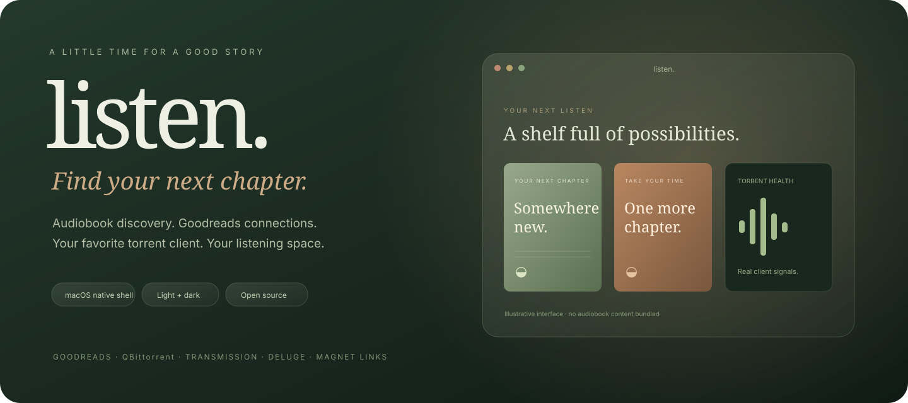

<p align="center"></p>

<p align="center">
<a href="https://github.com/Somamill/listen/releases"></a>
<a href="https://github.com/Somamill/listen/actions/workflows/tests.yml"></a>
<a href="LICENSE"></a>

</p>

<h1 align="center">listen.</h1>
<p align="center"><strong>A little time. A whole new world.</strong><br>A glass-inspired audiobook discovery app for macOS, with Goodreads connections and your favorite torrent client.</p>

<p align="center"><a href="https://github.com/Somamill/listen/releases">Download for Mac</a> · <a href="docs/GETTING_STARTED.md">Get started</a> · <a href="docs/PRIVACY.md">Privacy</a> · <a href="https://github.com/Somamill/listen/issues">Report a problem</a></p>

## Your reading world, ready to listen

- **Discover audiobook editions** by title or author, with configurable language, category, and tag filters.
- **Bring a Goodreads book** from Safari, a browser bookmarklet, or a pasted link. Review the edition before sending anything to a client.
- **Use your torrent client:** direct integrations for qBittorrent, Transmission, and Deluge Web; magnet-link handoff for other compatible clients.
- **See actual torrent health** from available client metrics. Search previews show “Health unknown” until the client connects.
- **Choose where books belong:** local folders, a remote client’s destination, or a cloud-drive folder. Downloads finish locally first. Use **Send to library** to move completed items when you choose; managed torrents move through the client so seeding can continue.
- **Make it yours:** light glass, dark glass, or system appearance, with a native Mac window, directory picker, keyboard shortcuts, optional Touch ID / Mac-password window lock, and a manual official-release update check.
- **Keep your setup local:** client passwords use the system credential store. Settings and reading progress stay on your machine; no hosted listen. account or analytics service.

## Download

Get the matching **Apple Silicon (`arm64`)** or **Intel (`x86_64`)** archive from [Releases](https://github.com/Somamill/listen/releases). The Mac app bundles its Python runtime; users do not need Homebrew, Docker, or a separate Python installation. A torrent client remains a separate application.

**Public beta:** these community builds are ad-hoc signed, not Apple Developer ID signed or notarized. macOS may block a downloaded build. The repository includes the complete source and build instructions; production notarization is not claimed. See [Apple’s guidance about apps from outside the App Store](https://support.apple.com/102445).

## Client compatibility

| Connection | Add magnets | Download status | Health signals | Per-download staging |
| --- | --- | --- | --- | --- |
| qBittorrent Web API | Yes | All torrents | Seeds, peers, availability, state | Local client |
| Transmission RPC | Yes | All torrents | Peers, rate, state; seeds may be unavailable | Configure Transmission’s incomplete directory |
| Deluge Web | Yes | All torrents | Exposed seeds, peers, availability, state | Local client |
| Any magnet-capable client | OS handoff | Managed by that client | Not available in listen. | Managed by that client |

Adapters have automated coverage. Live end-to-end testing is performed with qBittorrent; Transmission and Deluge require your own running server and have not been certified against every version. listen. does not promise every torrent or client version will work.

## Goodreads & browser connections

Sign in on **goodreads.com in your browser**, not in a listen. password form. Your browser retains its own session and cookies.

- **Connect Goodreads:** sign in once in a dedicated Safari window and allow the Mac Automation prompt. Your own My Books shelves refresh automatically every five minutes while the app and that window remain open, up to 2,000 books per refresh. Metadata covers appear automatically. Reconnect if Goodreads signs you out or you close the window. Other Safari tabs are not read.
- **Chrome, Firefox, Edge, Brave, and other browsers:** use the **Find with listen.** bookmarklet from the browser-connection dialog, or paste a Goodreads book URL. Browser/OS permission prompts and bookmarklet policies vary; pasting is the fallback.
- **Library export:** import a Goodreads CSV for books that cannot be read from the browser. This is a snapshot, not background account sync.
- Local **Want to listen / Listening / Finished** progress does not change Goodreads ratings or read status. Goodreads does not provide an official OAuth connection for this app. Sessions can expire and the site’s markup can change.

## How torrent health works

| Indicator | What it means |
| --- | --- |
| Sources available | Your client reports seeds or complete availability. |
| Active peers | Peers or a transfer are reported; completion is not guaranteed. |
| Waiting for sources | No active sources were reported at the last refresh. |
| Checking / metadata | The client is checking files or retrieving metadata. |
| Ready to listen | Your client reports the download complete. |
| Needs attention | The client reports an error or missing files. |

Health is **not** a malware assessment, a speed guarantee, or a privacy guarantee. listen. does not contact trackers for search previews. [Read the privacy details](docs/PRIVACY.md).

## Develop & build

```bash
git clone https://github.com/Somamill/listen.git
cd listen
python3.12 -m venv .venv
source .venv/bin/activate
python -m pip install -e '.[build]'
python -m unittest discover -s tests -v
python scripts/build_macos.py --dmg
```

Building the native shell requires macOS and Xcode Command Line Tools. Build each architecture on a matching runner; the release workflow builds Apple Silicon and Intel independently. Packaged users do not need these developer tools. See [development notes](docs/DEVELOPMENT.md).

## Project boundaries

The native download is for macOS 13+. Windows and Linux do not have native release packages yet. Remote torrent clients can run on other operating systems. Search availability and metadata depend on the catalog; Goodreads connections depend on its website. No content, audiobook files, private user data, proxy credentials, or personal filter choices are bundled.

## Credits & license

MIT licensed. Catalog parsing was adapted from [JamesRy96/audiobookbay-automated](https://github.com/JamesRy96/audiobookbay-automated); the original copyright and permission notice are preserved. See [LICENSE](LICENSE) and [third-party notices](THIRD_PARTY_NOTICES.md).
