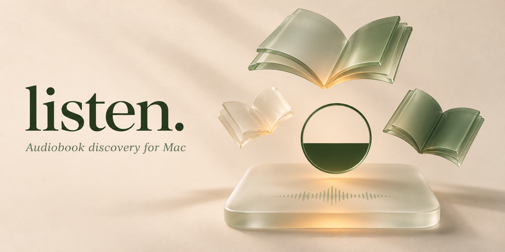

<picture>
  <source media="(prefers-color-scheme: dark)" srcset="docs/images/listen-audiobook-discovery-dark.png">
  
</picture>

<p align="center">
<a href="https://github.com/Somamill/listen/releases"></a>
<a href="https://github.com/Somamill/listen/actions/workflows/tests.yml"></a>
<a href="LICENSE"></a>

</p>

<h1 align="center">listen. — Audiobook Discovery for macOS</h1>
<p align="center"><strong>A little time. A whole new world.</strong><br>A glass-inspired audiobook discovery app for macOS, with Goodreads connections and your favorite torrent client.</p>

<p align="center"><a href="https://github.com/Somamill/listen/releases">Download for Mac</a> · <a href="docs/GETTING_STARTED.md">Get started</a> · <a href="docs/PRIVACY.md">Privacy</a> · <a href="https://github.com/Somamill/listen/issues">Report a problem</a></p>

<p align="center"><sub>Illustrated brand artwork · light and dark versions · see <a href="docs/images/ARTWORK.md">artwork notes</a></sub></p>

## Your reading world, ready to listen

- **Discover audiobook editions** by title or author, with configurable language, category, and tag filters.
- **Keep reading shelves separate:** Want to Read, Currently Reading, Read, and Did Not Finish, with completed books in their own section.
- **Bring a Goodreads book** from Safari, a browser bookmarklet, or a pasted link. Review the edition before sending anything to a client.
- **Start without API setup:** new installs send magnet links to the Mac’s default torrent app.
- **Use your torrent client:** optional direct integrations for qBittorrent, Transmission, and Deluge Web; magnet-link handoff for other compatible clients.
- **See actual torrent health** from available client metrics. Search previews show “Health unknown” until the client connects.
- **Choose where books belong:** local folders, a remote client’s destination, or a cloud-drive folder. With a direct local connection, downloads finish locally first. In magnet handoff mode, the client controls locations and progress. Use **Send to library** to move completed items when you choose; local managed torrents are removed after the client moves their files and listen. verifies the destination. Library files stay; empty local download folders are removed and seeding stops. Pending verification resumes on launch. Remote clients retain torrents.
- **Make it yours:** light glass, dark glass, or system appearance, with a native Mac window, directory picker, keyboard shortcuts, optional Touch ID / Mac-password window lock, and a manual official-release update check.
- **Keep your setup local:** client passwords use the system credential store. Settings and reading progress stay on your machine; no hosted listen. account or analytics service.

## Download

Get the matching **Apple Silicon (`arm64`)** or **Intel (`x86_64`)** archive from [Releases](https://github.com/Somamill/listen/releases). Install a compatible torrent app separately, then search and add a book through default-app handoff without Web UI setup. Direct integrations need the client’s address and credentials. The Mac app bundles its Python runtime; users do not need Homebrew, Docker, or a separate Python installation. A torrent client remains a separate application.

**Public beta:** these community builds are ad-hoc signed, not Apple Developer ID signed or notarized. macOS may block a downloaded build. The repository includes the complete source and build instructions; production notarization is not claimed. See [Apple’s guidance about apps from outside the App Store](https://support.apple.com/102445).

## Setup, updates, and release checks

See the [step-by-step Mac setup and update guide](docs/GETTING_STARTED.md). Preferences are per user and survive replacing the app. No personal profile, proxy, credentials, custom folders, or exclusion list is embedded. See the [release-readiness report](docs/RELEASE_READINESS.md) for validation and remaining limits.

## Client compatibility

| Connection | Add magnets | Download status | Health signals | Per-download staging |
| --- | --- | --- | --- | --- |
| qBittorrent Web API | Yes | All torrents | Seeds, peers, availability, state | Local client |
| Transmission RPC | Yes | All torrents | Peers, rate, state; seeds may be unavailable | Configure Transmission’s incomplete directory |
| Deluge Web | Yes | All torrents | Exposed seeds, peers, availability, state | Local client |
| Any magnet-capable client | OS handoff | Managed by that client | Not available in listen. | Managed by that client |

Adapters have automated coverage. Live end-to-end testing is performed with qBittorrent; Transmission and Deluge require your own running server and have not been certified against every version. listen. does not promise every torrent or client version will work.

## Goodreads & browser connections

Choose **Connect Goodreads** to sign in on the real Goodreads website inside listen.’s dedicated window. Its persistent WebKit session is independent of Safari. The local service never receives your password or cookies. Manual browser and CSV imports remain available as fallbacks.

- **Connect Goodreads:** sign in once in listen.’s dedicated Goodreads window. The app keeps its own persistent website session and refreshes your My Books shelves every five minutes while open, independently of Safari or other browsers. Reconnect if Goodreads expires the session. Up to 2,000 books per refresh; high-resolution metadata covers appear automatically.
- **Chrome, Firefox, Edge, Brave, and other browsers:** use the **Find with listen.** bookmarklet from the browser-connection dialog, or paste a Goodreads book URL. Browser/OS permission prompts and bookmarklet policies vary; pasting is the fallback.
- **Library export:** import a Goodreads CSV for books that cannot be read from the browser. This is a snapshot, not background account sync.
- Local **Want to listen / Listening / Finished** progress does not change Goodreads ratings or read status. Goodreads does not provide an official OAuth connection for this app. Sessions can expire and the site’s markup can change.

## How torrent health works

| Indicator | What it means |
| --- | --- |
| Sources available | Your client reports seeds or complete availability. |
| Active peers | Peers or a transfer are reported; completion is not guaranteed. |
| Waiting for sources | No active sources were reported at the last refresh. |
| Checking / metadata | The client is checking files or retrieving metadata. |
| Ready to listen | Your client reports the download complete. |
| Needs attention | The client reports an error or missing files. |

Health is **not** a malware assessment, a speed guarantee, or a privacy guarantee. listen. does not contact trackers for search previews. [Read the privacy details](docs/PRIVACY.md).

## Develop & build

```bash
git clone https://github.com/Somamill/listen.git
cd listen
python3.12 -m venv .venv
source .venv/bin/activate
python -m pip install -c constraints.txt -e '.[build]'
python -m unittest discover -s tests -v
python scripts/build_macos.py --dmg
```

Building the native shell requires macOS and Xcode Command Line Tools. Build each architecture on a matching runner; the release workflow builds Apple Silicon and Intel independently. Packaged users do not need these developer tools. See [development notes](docs/DEVELOPMENT.md).

## Project boundaries

The native download is for macOS 13+. Windows and Linux do not have native release packages yet. Remote torrent clients can run on other operating systems. Search availability and metadata depend on the catalog; Goodreads connections depend on its website. No content, audiobook files, private user data, proxy credentials, or personal filter choices are bundled.

## Credits & license

MIT licensed. Catalog parsing was adapted from [JamesRy96/audiobookbay-automated](https://github.com/JamesRy96/audiobookbay-automated); the original copyright and permission notice are preserved. See [LICENSE](LICENSE) and [third-party notices](THIRD_PARTY_NOTICES.md).

### Matching qBittorrent desktop themes

Cream/sage and forest themes are available in [extras/qbittorrent](extras/qbittorrent), with editable sources and installation instructions. Theme selection is manual and does not change privacy or network settings.

## Native iPhone, iPad & Mac player

A separate native audiobook player is available as source in [ios/](ios/README.md), with local/Files/ZIP imports, playback controls, Goodreads shelves, automatic metadata, AAC/M4B conversion, iCloud library/progress sync code, media-server downloads, browser transfers, and widget/share extensions. It contains no torrent features. See the setup guide and feature matrix for verified behavior and pending signed-device/App Store work. The sandboxed Mac Catalyst edition builds as **listen Player.app**, alongside the existing desktop app. Version 1.0.0 (3) passes unsigned iOS/Mac archive checks and simulator tests. App Store signing and submission are still pending; no Store binary is available yet. See [release status](app-store/RELEASE-STATUS.md) and the [Store privacy policy](app-store/PRIVACY.md).
